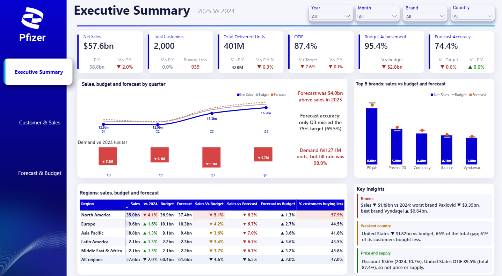
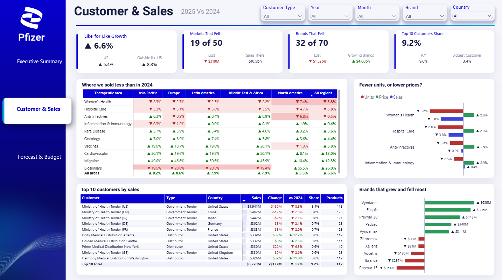
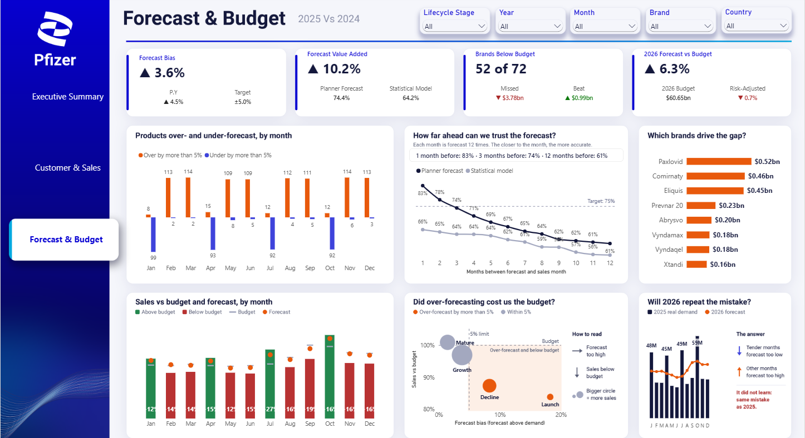

# Pfizer Sales, Forecast & Budget Dashboard

Three-page Power BI dashboard that explains **why 2025 sales missed budget and how wrong the demand forecast was**. It is built on a simulated Pfizer dataset (2023–2025, plus the 2026 forecast and budget), starting from a deliberately messy 3.2M-row sales table that was profiled and cleaned in MySQL.

> **Simulated data.** All transactions, customers and orders are fictional and were generated in Python. Brand-level yearly totals were scaled to Pfizer's publicly reported revenue (FY2024 and FY2025 earnings releases), and real brand names are used. No real company data is included. KPI targets (OTIF 95%, accuracy 75%, bias ±5%) are assumptions.

## Pages

### 1. Executive Summary

*How did 2025 compare with 2024 and with targets, and why did sales fall?*
Six KPI cards (Net Sales $57.6bn, Customers, Delivered Units, OTIF 87.4%, Budget Achievement 95.4%, Forecast Accuracy 74.4%) with prior-year and target comparisons. Sales vs budget vs forecast by quarter with dynamic story text, demand change vs 2024, top 5 brands against budget and forecast, a regions table with conditional colours, and three **Key insights** cards whose text changes with the filters.

### 2. Customer & Sales

*Are we really shrinking, where, and is it units or price?*
Like-for-like growth (excluding Paxlovid and Comirnaty), markets and brands that fell, top-10 customer share; a therapeutic area × region matrix of where sales dropped; a units vs price vs sales breakdown; the top 10 customers; and the brands that grew and fell most.

### 3. Forecast & Budget

*How biased was the forecast, did planners add value, and will 2026 repeat the mistake?*
Forecast bias, forecast value added (planner vs statistical model), brands below budget and 2026 forecast vs budget. Products over- and under-forecast by month, accuracy by forecast lag (1–12 months), the brands driving the gap, monthly sales vs budget and forecast, a lifecycle-stage bubble chart, and 2025 demand vs the 2026 forecast.

## Key findings (2025 vs 2024, simulated)

- Net sales were **$57.6bn, down 2.0%**, reaching 95.4% of the $60.4bn budget (a $2.8bn gap).
- **It's a product story, not price or supply.** Paxlovid fell $3.35bn (−59%), while Vyndaqel, Eliquis and Prevnar 20 added $1.67bn. Discounts were flat (10.7% → 10.6%), prices rose about 3% in every region, units fell 6.3%, and the fill rate was 98%.
- **Like-for-like sales grew 6.6%** once the COVID brands are removed.
- North America (−4.1%) carries 67% of the budget gap, and 58% of its customers bought less.
- The forecast was $4.0bn above sales (bias +3.6%). That hides **opposite errors**: the four tender months (Jan, Apr, Jul, Oct) were under-forecast and the other eight were over-forecast.
- Planners beat the statistical model by **10.2 points** (74.4% vs 64.2%). Accuracy falls from 83% one month ahead to 61% twelve months ahead.
- Launch brands were forecast 18.3% too high and reached only 83.9% of budget.
- **2026 repeats the mistake:** tender months were 49% of 2025 demand but only 33% of the 2026 forecast. After applying the 2025 hit rate, the forecast drops from +6.3% above budget to −0.7%.

## Data preparation (MySQL 8)

The raw sales export (3,232,764 lines, every column stored as text) was profiled first. All 32 problem types were logged, then fixed on a copy (`sales_clean`), with `sales_raw` kept as a backup. Result: **3,228,213 clean rows**, typed with 0 warnings.

| Step | What was fixed |
|---|---|
| 1. Junk rows | 21 empty rows, 30 test rows, 4,500 duplicate order lines (`ROW_NUMBER()` over an indexed key) |
| 2. Codes | Upper-case customer codes (16,253); product codes trimmed, `SKU-` removed and zero-padded to 8 digits (66,382) |
| 3. Text | Country names and order status unified; fake empty cancel reasons set to NULL |
| 4. Fill from masters | Names, types, cities, brands via `UPDATE … JOIN`; 495 missing customer codes taken from the same order; 5 lines set to "Unknown Customer" |
| 5. Dates | 4 date formats unified (158,793); 180 future years and 180 impossible dates; 6,394 lines delivered before ordered |
| 6. Numbers | Thousands commas, N/A/negative/×1000 quantities, "%" discounts (32,201), "$" and decimal-comma prices (48,349), 3,214 zero prices filled from a new price-list table |
| 7. Net sales | Recalculated as delivered × price × (1 − discount) where it was off (9,697 lines) |
| 8. Types | One `ALTER TABLE` to INT / DATE / DECIMAL |

Power BI reads the clean table from MySQL through a read-only user.

## Data model

Star schema. **Facts:** Sales (3.2M lines), Forecast (1.37M rows: product × country × target month × lag 1–12), Demand History (96,696), Budget (66,455), Demand Events (124). **Dimensions:** Calendar (2023–2026, marked as date table), Products (133 SKUs), Customers (2,000), Geography (22 countries, 5 regions), Brand (72). All relationships are many-to-one, single direction.

## Techniques used

- **SQL:** data profiling, `UPDATE … JOIN`, subqueries, window functions, indexes, a helper lookup table, `ALTER TABLE` typing
- **DAX:** Selected Year pattern for CY vs PY; forecast accuracy as 1 − WMAPE at lag 3; bias; forecast value added; lag analysis; `RANKX` / `TOPN`; like-for-like growth; dynamic text measures; colour measures through conditional formatting
- **Demand planning:** forecast accuracy, bias, lag analysis, FVA, OTIF, fill rate, budget vs actual vs forecast, lifecycle stages, tender seasonality
- **Design:** designed page backgrounds, a page navigator, edited interactions, chart titles written as business questions
- **Python** (pandas, NumPy) to generate the simulated data

## Files

- `Pfizer.pbix` — the full Power BI file (about 100 MB), attached to the [latest release](../../releases/latest) because it is too large for the repository
- `sql/01_setup_mysql.sql` — creates the database and loads the raw files
- `sql/02_sales_cleaning.sql` — the full cleaning script, step by step
- `data/` — data dictionary and the smaller master tables
- `screenshots/` — page exports from Power BI Desktop

The raw sales files (~250 MB per year) and the forecast table (~80 MB) are too large for GitHub and are not included.

## Author

Mohamed Yasser Kamal — [mohamedyasser6044@gmail.com](mailto:mohamedyasser6044@gmail.com)
